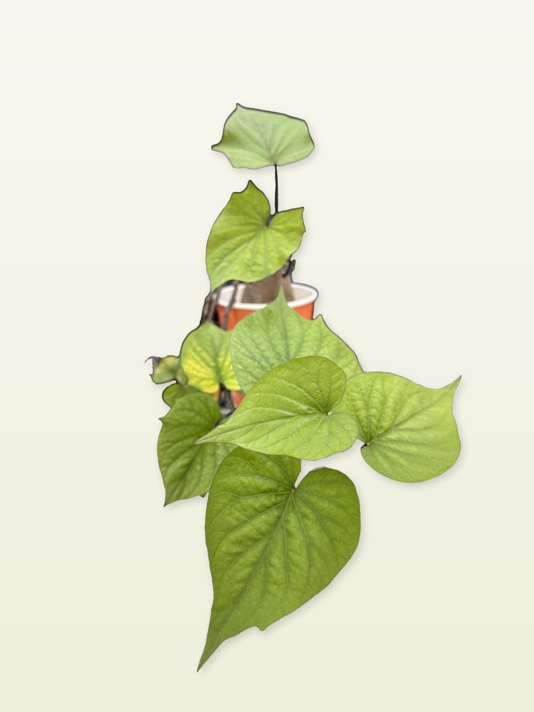

昨天（11/19）SR71 在 X 上發了四則貼文。天氣轉冷，三則跟過冬有關，一則跟 AI 時代的人有關。

## 天冷了，加衣帶傘

> 天冷了，大家留意氣象報告加衣帶傘，可別感冒了😷

[原文](https://x.com/knight272001/status/2123237780314530236)

## 獨居的人，多看一眼

> 天氣更冷了，大家多關心周邊獨居人士，使用瓦斯器具注意通風避免一氧化碳中毒意外，平平安安度過冬天！

冬天關窗、開熱水器、煮火鍋，通風不良就有一氧化碳的風險。家裡或鄰居有獨居長輩的，打個電話、敲個門。

[原文](https://x.com/knight272001/status/2123327288213160201)

## 有空玩玩 Padlet

> padlet 是具有智慧的線上教學輔助軟體，有空時玩玩看：）

[原文](https://x.com/knight272001/status/2123226844048556363)

## 時代愈快，心愈要定

> 天地變幻萬千，AI巧奪天工，碳基文明有可能被矽基文明取代，人類更需要思索並且證明自己的定位，時代愈快，心愈要定。

[原文](https://x.com/knight272001/status/2123358339631288645)
