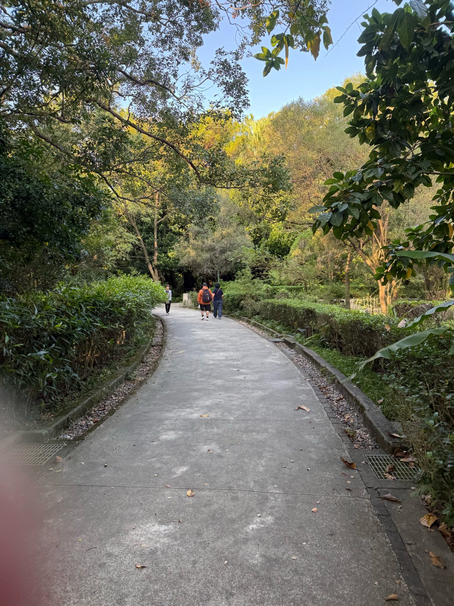

\*\*\*\*\* 以下這段文字摘自UDN STYLE之霍建華新劇報導，觀者自尋哦\*

歲月並未溫柔以待任何人，昔日兄弟各自被現實困境擊中，有人坐擁財富卻健康亮紅燈，有人為孩子教育焦頭爛額，有人身處高管位置卻面臨裁員危機，也有人在婚姻關係裡進退失據。

\*\*\*我摘錄完了\*\*\*

如果拿這段文字去描述參加同學會眾人的檯面下心情寫照，比對社交媒體上的光鮮亮麗、豪宅美食，感覺蠻貼切。

也無怪乎網路原生世代的小朋友們，很容易得著憂鬱症--如果一個孩子從出生就身處於楚門的世界裡，他或她往往就不容易理解社交媒體的螢光幕前後，有些像珍珠板大圖輸出的前後一般強烈對比，珍珠板前有聚光燈沒有陰暗死角，珍珠板後往往處處都得打手電筒或引電源方得照明。

非網路原生世代的我們，也才知道螢光幕豎立在每個人之前的生活面貌究竟如何，也很清楚真正的生活是啥滋味。只是社交媒體的特性不適合說憂難討拍慰，家家那本不好唸的經，大家都很有默契地放在螢幕後面。

大學同學在喟歎國際時事的巨變，我很不識趣地在同學臉書內留下了這些話：

君子務本，本立而道生。亂世之中我們只能一再審視自己的核心價值以及終極關懷所在， 珍惜自己的家人及好友，把握珍貴的餘生做我們真正想做的事情。跟同學共勉:)

想起管中閔校長當初引的這句話，細看居然源自金庸先生的倚天屠龍記中字句，如今引來，一樣適用:

他強由他強，清風拂山崗，他橫任他橫，明月照大江。

臺語有句俚語「歹年冬熬蕭郎(瘋子特多之意)」，混亂的年代咱們做好自省自進之事，顧好家人親友，行有餘力不忘做些公益，也便是了:)

(這真的是這幾年來我自己心情的寫照耶)

正好看到羅紹和發言人的安德烈基金會在募年菜的活動，不自量力地在這兒轉貼一下，請各位師長親友在張羅自家年菜之餘，也能幫忙弱勢同胞張羅年夜飯，讓更多目前陷於困難的朋友們，在寒冬中也能感受到一絲暖意。

Love wins all.我真的相信當臺灣成為全世界最有愛、最能把愛向全世界各地輸出的地方之後，臺灣會成為任何人或無名力量都捨不得摧毀、無意也無力摧毀的地方。

請大家繼續保重注意安全哦：）
